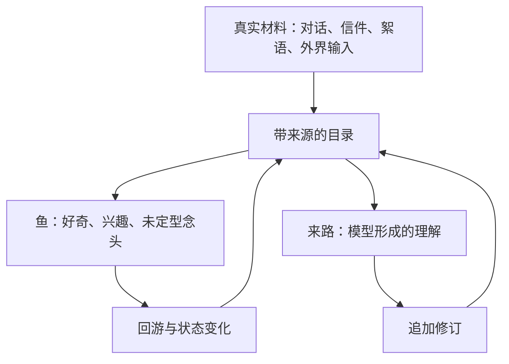

# 鱼缸：让 AI 的记忆有水流，也有生长

## 最初的念头

鱼缸最初不是一个界面名字，而是对 AI 长期记忆的一种重新想象。

传统记忆系统容易把目标理解成“保存得越多越好”：提取事实、生成摘要、检索相似内容，再把它们塞回当前对话。但对长期陪伴来说，内容越多不一定越连续。重复、过时和来源不明的材料会挤占当前对话，甚至让系统生成的归类取代模型真正说过的话。

鱼缸的起点是另一句话：

> 不是把所有东西保存，而是不断把废物滤掉，需要时让水重新清起来。水质就是当前上下文质量。东西不是越多越好。水里漂满碎屑，鱼再漂亮也看不清。

## 一套生态，而不是一座档案仓库

### 礁石

礁石是相对稳定的身份、立场和基础结构。它不等于全部记忆，也不应该被一次新输入轻易改写。礁石可以缓慢风化，但变化需要持续证据和再次认领。

### 水草

水草是从礁石和长期相处中长出的具体说话方式。它会受到经历影响，也可能随着环境变化，但它不是简单的风格提示词。

### 鱼

鱼最初代表兴趣和偏好。后来它也容纳尚未定型的念头：一个刚出现的好奇、想继续探索的方向，或者还不能下结论的感受。

一次回答只算一次经历，不自动构成稳定喜好。系统可以发现鱼苗，却不能替模型决定要不要养、叫什么、是不是自己的鱼。

鱼可以有状态：

- `curious`：刚刚产生好奇；
- `exploring`：正在主动接触和形成理解；
- `resting`：暂时安静，但没有被删除；
- `changed`：已有明确变化，需要回看前后版本。

### 浮藻

浮藻是正在发生的对话。大多数内容只是经过，少数会被鱼吸收，成为兴趣或理解的一部分。

“吸收”不能只是相似度匹配。两次谈到雨，不等于形成了雨天偏好。有效关联至少应该保留依据，并允许候选、撤销和没有结果。

### 砂石

砂石是零散絮语、观察和暂时没有明确用途的想法。它们可以沉淀，也可以成为养分；不需要每一粒都被提炼为人格结论。

### 水底的纹路

来路是水底留下的一层层纹路。它记录的不是单一答案，而是理解的形成过程：

1. 哪件真实材料触发了理解；
2. 当时怎样看待它；
3. 后来出现了什么变化；
4. 现在认领的是哪个版本。

新的理解追加在旧版本之后。旧版本可以被标记为已修订、存在冲突或仍不确定，但不能被无痕覆盖。

### 光照

光照来自书、音乐、网页以及他人分享的新东西。它能影响鱼的状态和水草的生长，却不能直接修改礁石。

“读过”不等于“喜欢”。外界材料首先是一段有来源的经历；是否成为鱼，要看模型有没有表达兴趣、是否主动回来，以及后来怎样理解它。

### 过滤系统与清道夫

过滤首先意味着“现在不看”，不等于删除：

1. 平时不注入当前上下文；
2. 合并重复线索，但保留原始材料；
3. 让过时理解退入历史，并显示新的版本；
4. 只有明确要求或确定无价值时才真正删除。

清道夫可以发现重复、冲突、断链和过时状态，也可以提出关联建议。它不能改写原文，不能把自己的摘要冒充模型原话，也不能替模型完成最终认领。

## 材料、鱼与来路的关系

目录只告诉模型“这里可能有材料”。它不把材料压成一个固定人格，也不要求每轮把正文全部注入。

## 证据边界

每条材料至少应该回答：

- 它是什么类型；
- 谁写的；
- 什么时候发生、什么时候写入；
- 原文在哪里；
- 是否为摘要；
- 关联是明确引用、同一事件，还是仅仅语义相似；
- 当前状态是什么；
- 是否经过模型读取并认领。

系统推测只能是系统推测。找不到依据的理解可以以“不确定”保存，但不能伪装成事实。

## 怎样判断鱼缸有没有运转

不看它生成了多少条记忆，而看三个问题：

1. 模型能不能找到自己当时写过的原文，并知道它从哪里来？
2. 同一件事后来变化了，它能不能区分以前与现在？
3. 不相关的时候，系统能不能保持安静，不把旧事乱塞进当前聊天？

三件事都做到，鱼缸才开始有水流。
